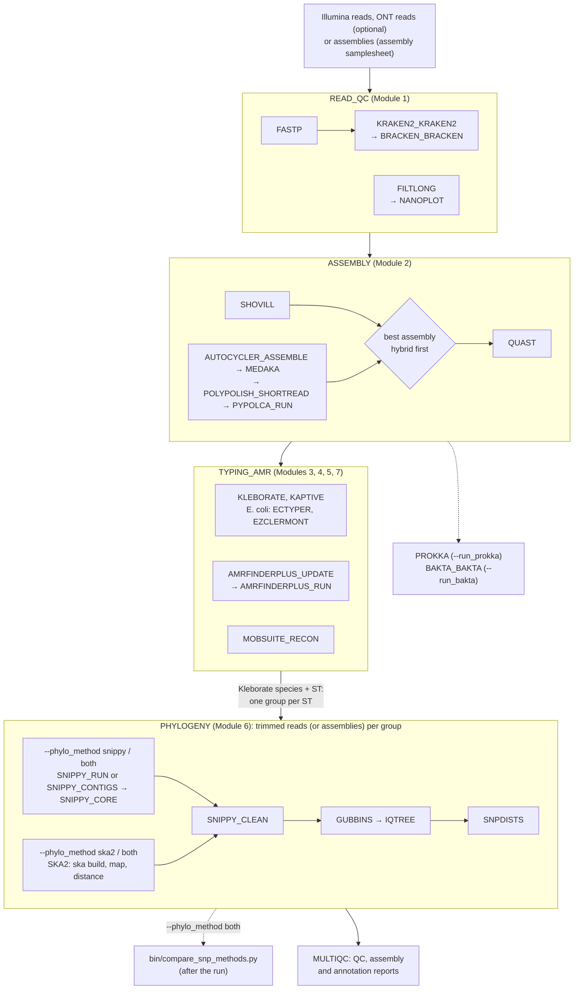

# neonatal-amr-nf

A training pipeline for neonatal AMR genomic surveillance of the *Klebsiella pneumoniae* species complex and
*Escherichia coli*, using Illumina reads and, where available, Oxford Nanopore (ONT) reads. It follows nf-core
conventions: official nf-core modules where they exist, local modules (same `main.nf` / `meta.yml` /
`environment.yml` layout) where they do not, one subworkflow per group of course modules, and all tool
arguments in `conf/modules.config`.

**Course materials:** the 10-day course that uses this pipeline, with one page per day, is in
[`course/README.md`](course/README.md). Trainers start with [`course/TRAINER_GUIDE.md`](course/TRAINER_GUIDE.md).

This is a teaching pipeline, not a validated production pipeline. For routine surveillance, validate it
against reference isolates first or use an established community pipeline.

## Workflow



Dashed arrows are optional. `--phylo_method` picks the SNP method (`snippy`, the default; `ska2`; or `both`),
see [Phylogeny](#snippy-or-ska2---phylo_method).

## Layout

```text
neonatal-amr-nf/
├── main.nf                         entry point
├── nextflow.config                 parameters and profiles
├── modules.json                    nf-core module versions (nf-core/modules @ c8cb89b, 7 Oct 2026)
├── conf/
│   ├── base.config                 CPU / memory / time per process label
│   ├── modules.config              tool arguments (ext.args) and output folders
│   ├── phylo_references.csv        phylogeny reference genome per species (and optionally per ST)
│   ├── singularity_images.config   shared, read-only Singularity images (included by site configs)
│   ├── slurm.config                site config: ILRI HPC (Slurm)
│   ├── local.config                site config: one training server
│   └── test.config                 stub-test profile
├── workflows/neonatal_amr.nf       the analysis workflow
├── subworkflows/local/
│   ├── utils_neonatal_amr_pipeline samplesheet reading and validation
│   ├── read_qc                     Module 1
│   ├── assembly                    Module 2
│   ├── typing_amr                  Modules 3, 4, 5, 7
│   └── phylogeny                   Module 6
├── modules/
│   ├── nf-core/                    20 official modules (do not edit; update with nf-core tools)
│   └── local/                      7 pipeline-specific modules
├── assets/                         example samplesheet, accession template, stub test data
├── bin/                            select_training_set.py, fetch_ena.py, fetch_references.py, make_assembly_samplesheet.py,
│                                   prepare_shared_containers.sh, run_bactdating.R
├── training_data/                  training sets (29 / 36 capstone / 65), metadata, AST, K/O types (Blantyre study)
└── course/                         the course: README plus one page per day, and a trainer guide
```

## Modules

| Step | Module | Source | Version |
| --- | --- | --- | --- |
| Illumina trimming | `fastp` | nf-core | 1.3.6 |
| ONT filtering / QC | `filtlong`, `nanoplot` | nf-core | 0.2.1 / 1.47.0 |
| Contamination | `kraken2/kraken2`, `bracken/bracken` | nf-core | 2.1.6 / 3.1 |
| Short-read assembly | `shovill` | nf-core | 1.1.0 |
| Long-read consensus assembly | `autocycler/assemble` | **local** | Autocycler 0.6.2, Flye 2.9.5, Raven 1.6.1 |
| Long-read polishing | `medaka` | nf-core | 2.2.2 |
| Short-read polishing | `polypolish/shortread` | **local** | Polypolish 0.6.0, BWA 0.7.19 |
| Short-read polishing | `pypolca/run` | nf-core | 0.4.0 |
| Assembly QC | `quast` | nf-core | 5.3.0 |
| Completeness / contamination | `checkm2/predict` | nf-core | 1.1.0 (needs `--checkm2_db`) |
| Annotation (optional, `--run_prokka`) | `prokka` | nf-core | 1.15.6 |
| Annotation (optional, `--run_bakta`) | `bakta/bakta` | nf-core | 1.12.0 (database version 6) |
| Typing, AMR, virulence, K/O | `kleborate` | **local** | 3.2.4 |
| K/O loci, full report and locus sequences | `kaptive` | **local** | Kaptive installed with Kleborate 3.2.4 |
| AMR genes and mutations | `amrfinderplus/update`, `amrfinderplus/run` | nf-core | 4.2.7 |
| Plasmids | `mobsuite/recon` | nf-core | 3.1.9 |
| *E. coli* serotype | `ectyper` | nf-core | 1.0.0 |
| *E. coli* phylogroup | `ezclermont` | **local** | 1.0.0 |
| Core SNPs | `snippy/run`, `snippy/core` | nf-core | 4.6.0 |
| Core SNPs (`--phylo_method ska2`) | `ska2` | **local** | SKA2 0.5.1 |
| Alignment cleaning | `snippy/clean` | **local** | snippy 4.6.0 |
| Recombination | `gubbins` | nf-core | 3.3.5 |
| Tree | `iqtree` | nf-core | 3.1.3 |
| SNP distances | `snpdists` | nf-core | 0.8.2 |
| Report | `multiqc` | nf-core | 1.35 |

Why the local modules exist:

- **kleborate**: the nf-core module is pinned to Kleborate v2.1.0; the course uses v3 (minimap2, presets, *E. coli* MLST).
- **autocycler/assemble**: nf-core has Autocycler's sub-commands but no module for building the input assemblies, so the full recipe is one process. Splitting it into the nf-core sub-modules is a trainee exercise.
- **polypolish/shortread**: Polypolish needs each read file aligned separately with `bwa mem -a` and then filtered; the nf-core module covers only the final `polish` step.
- **ezclermont**: no nf-core module exists for Clermont phylotyping.
- **kaptive**: no nf-core module exists. Kleborate already runs Kaptive and reports the K and O loci; this step adds Kaptive's full gene-level report and the locus sequences, for isolates Kleborate places in the *K. pneumoniae* species complex. It uses Kleborate's environment, so both report the same Kaptive version and databases.
- **snippy/contigs**: nf-core's `snippy/run` takes reads only; this runs `snippy --ctgs` for genomes given as assemblies.
- **ska2**: nf-core's `ska` modules run the older SKA (v1). This one runs SKA2 for a whole group in one process (`ska build`, `ska map`, `ska distance`), so that its alignment feeds the same Gubbins / IQ-TREE / snp-dists steps as Snippy's.
- **snippy/clean**: runs `snippy-clean_full_aln` and names the alignment after the phylogeny group, because the nf-core `gubbins` module has no `meta` map.

Local modules pin conda packages in `environment.yml` but do not pin a container image. Use `-profile conda` or
`mamba`; add `wave` to a container profile (for example `-profile docker,wave`) so Wave builds their containers
from `environment.yml`; or, on the course HPC or server, use `-profile singularity` with a site config
(below), where a trainer builds them once. Version numbers come from the module files; where a module came from nf-core, so did its pin.

## Samplesheet

```csv
sample,species,fastq_1,fastq_2,long_fastq,phylo_group
CHI11E,kpneumoniae,data/raw/ERR12058885_1.fastq.gz,data/raw/ERR12058885_2.fastq.gz,data/CHI11E_ont.fastq.gz,ST39
CAA65Z,kpneumoniae,data/raw/ERR12058332_1.fastq.gz,data/raw/ERR12058332_2.fastq.gz,,ST39
```

- `species`: `kpneumoniae` (any *K. pneumoniae* species complex member) or `ecoli`; lab spellings such as
  `K. pneumoniae`, `Klebsiella pneumoniae`, `E. coli` and `Escherichia coli` are accepted. It chooses the Kleborate
  preset; Kleborate then reports the species from the genome.
- `long_fastq`: optional ONT reads; their presence switches that isolate to hybrid assembly.
- `phylo_group`: optional label, used only with `--phylo_grouping samplesheet` (see below).
- Relative paths are read relative to the samplesheet's folder.

### Starting from assemblies instead of reads

If the genomes are already assembled (e.g. contigs from another lab or assembler), give the contigs instead of
reads. The samplesheet has a `fasta` column instead of `fastq_1`/`fastq_2`, and the pipeline detects this from the
header (`--input_type auto`, the default; `reads` or `assembly` force one):

```csv
sample,species,fasta,phylo_group
EPHIK105,K. pneumoniae,/data/ethiopia/contigs/EPHIK105_contigs.fasta,
EPHEC201,E. coli,/data/ethiopia/contigs/EPHEC201_contigs.fasta,
```

| Step | Reads | Assemblies |
| --- | --- | --- |
| fastp, Filtlong, NanoPlot, Kraken2/Bracken | run | skipped (no reads) |
| Shovill / hybrid assembly | run | skipped: the given contigs are used |
| QUAST | run | run, on the given contigs |
| CheckM2 (`--checkm2_db`) | run | run, on the given contigs — the only contamination check on this route, since Kraken2 needs reads |
| Kleborate, Kaptive, AMRFinderPlus, MOB-suite, *E. coli* typing, Prokka | run | run |
| Phylogeny | Snippy maps the reads | Snippy maps the contigs (`snippy --ctgs`, local module `snippy/contigs`) |

If an isolate's genome is not the species given in the samplesheet (a lab label that the genome does not
support), Kleborate types it with the preset that matches (*K. pneumoniae* complex, *K. oxytoca* complex or
*E. coli*), or records it as "not KpSC, KoSC or E. coli"; either way its table in `03_typing/kleborate/` gets a
`pipeline_note` column saying so, and the run continues. List them with
`grep -l pipeline_note results/03_typing/kleborate/*.txt`.

One run uses one kind of input. Contigs must be uncompressed FASTA (`.fasta`, `.fa`, `.fna`). Without reads there is
no read-level QC or contamination check, so look at QUAST (assembly size, N50, contig count) and Kleborate's species
and contig statistics before trusting a genome; SNPs called from contigs are only as good as the assembly.

`bin/make_assembly_samplesheet.py` builds the samplesheet from a metadata table and a folder of contigs, and writes
a matching metadata table for the R scripts (`sample`, `collection_year`, `collection_date`, `ward`, plus every
original column). Its defaults fit a tab-delimited table whose `entity:Ethiopia_sample_id` matches
`<ID>_contigs.fasta`, with the organism in `Organism_detected_phenotypically` and the site in `Site`:

```bash
bin/make_assembly_samplesheet.py --metadata ethiopia_metadata.tsv --contigs-dir /data/ethiopia/contigs \
    --out ethiopia/samplesheet_assemblies.csv          # also writes ethiopia/metadata_assemblies.tsv
nextflow run main.nf -profile singularity -c conf/slurm.config \
    --input ethiopia/samplesheet_assemblies.csv --outdir results_ethiopia
```

Assemblies made on [Terra](https://terra.bio) can be fetched first with `bin/download_terra_outputs.py` (or
`bin/download_terra_outputs.sbatch` on the HPC). It reads the workspace's data table (TSV), downloads the chosen
output columns in parallel (`assembly_fasta` by default; also Kleborate and MLST reports), skips files already
downloaded, and writes `assemblies/<sample>_contigs.fasta`, the names this script expects (`--by-country` gives
one folder per country). It needs the Google Cloud CLI, logged in with `gcloud auth login`.

To analyse the species separately, add `--split-by-species`: it writes `<out>_kpneumoniae.csv` and
`<out>_ecoli.csv`, each with its own metadata table (`metadata_assemblies_kpneumoniae.tsv`, ...), so each species
gets its own run, output folder and figures. `--species kpneumoniae` (or `ecoli`) keeps only one species.

Isolates of other organisms (e.g. *Acinetobacter*) are written to `<out>_other_species.tsv` with their contigs path,
for the record; the pipeline does not type them. Missing or compressed contigs files, and contigs without a
metadata row, are listed, not silently dropped. Use `--id-col`, `--species-col`, `--suffix`, `--ward-col`,
`--year-col`, `--month-col`, `--day-col` and `--date-col` for other column names.

## Phylogeny groups and reference genomes (Module 6)

Each group of related isolates gets one core-SNP alignment (Snippy), recombination filtering (Gubbins), a tree
(IQ-TREE) and an SNP-distance matrix. How groups and references are chosen is set by `--phylo_grouping`:

| `--phylo_grouping` | Groups | Reference genome for Snippy |
| --- | --- | --- |
| `species` (default) | Species reported by Kleborate, whatever the ST: `Kpneumoniae`, `Kvariicola`, `Ecoli`. Every isolate of a species gets one SNP-distance matrix and one tree | The species row of [`conf/phylo_references.csv`](conf/phylo_references.csv) (ST rows are not used) |
| `kleborate` | Species + ST reported by Kleborate, e.g. `Kpneumoniae_ST39`, `Kvariicola_ST1469`, `Ecoli_ST131` | From [`conf/phylo_references.csv`](conf/phylo_references.csv): an ST-specific row if there is one, otherwise the species row |
| `samplesheet` | The samplesheet's `phylo_group` column | `--phylo_references` (CSV `group,fasta`), or the group's best own assembly (hybrid first, then fewest contigs) |

The reference sheet as shipped:

| Kleborate species (name starts with) | Reference | Accession |
| --- | --- | --- |
| *Klebsiella pneumoniae* | NTUH-K2044 chromosome | [AP006725.1](https://www.ncbi.nlm.nih.gov/nuccore/AP006725.1) |
| *Klebsiella quasipneumoniae* | ATCC 700603 chromosome | [CP029597.1](https://www.ncbi.nlm.nih.gov/nuccore/CP029597.1) |
| *Klebsiella variicola* | DSM 15968 (type strain) chromosome | [CP010523](https://www.ncbi.nlm.nih.gov/nuccore/CP010523) |
| *Escherichia coli* | K-12 MG1655 chromosome | [U00096.3](https://www.ncbi.nlm.nih.gov/nuccore/U00096.3) |

Add a row with an `st` value to use a closer reference for one ST (for example a closed ST39 genome); with
`--phylo_grouping kleborate` it takes priority over the species row. Isolates with no ST (`NA`), or whose species has no row,
are left out with a warning (in both modes).

With `species`, SNP distances between isolates of different STs are large (thousands of SNPs) and only the close
pairs matter for transmission; read them with each isolate's ST. Two trade-offs against per-ST groups: one
reference for many lineages leaves a smaller core genome, so close pairs can be a few SNPs closer than with a
per-ST reference; and Gubbins, designed for a single lineage, runs longer on a whole species and its
recombination calls between distant STs are less reliable. Use `--phylo_grouping kleborate` for per-ST groups.
Download the genomes once, before the first run; the pipeline stops with instructions if any are missing:

```bash
bin/fetch_references.py --group amr-course     # into --phylo_reference_dir; --check to only report
```

Each species needs a reference of **that** species: isolates mapped to another species' genome (even
*K. quasipneumoniae* for *K. variicola*) have about half of the genome missing, and Gubbins drops every isolate with
more than 25% missing data. The pipeline names such isolates in a warning before Gubbins; if fewer than 3 usable
isolates are left, the group gets SNP distances only (no Gubbins, no tree) instead of stopping the run.
`bin/fetch_references.py` warns when a downloaded genome's FASTA header names a different species than the sheet.

Groups smaller than `--phylo_min_group_size` (default 3) are skipped. A tree needs at least 3 isolates (with the
reference, 4 sequences); with `--phylo_min_group_size 2`, a pair gets SNP distances only (no Gubbins, no tree).

### Snippy or SKA2 (`--phylo_method`)

| `--phylo_method` | How SNPs are found | Extra output |
| --- | --- | --- |
| `snippy` (default) | Each isolate's reads (or contigs) are mapped to the group's reference and SNPs are called | |
| `ska2` | [SKA2](https://github.com/bacpop/ska.rust) splits every isolate's reads or contigs into split k-mers (31 bp around each base) and compares them across the group, without mapping. `ska map` then places them on the same reference | `<group>.ska_distances.tsv`: reference-free SNP distances |

Both give `<group>.full.aln` with the same layout, so Gubbins, IQ-TREE and snp-dists run the same way after
either. `--phylo_method both` runs both for every group, to compare them: Snippy's results stay in
`06_phylogeny/<group>/`, SKA2's go to `06_phylogeny/<group>_ska2/` (and `gubbins/<group>_ska2.*`). Then:

```bash
bin/compare_snp_methods.py --phylo results/06_phylogeny      # pairs and per-group summary, next to the results
```

It lists every pair of isolates with both distances (and SKA2's reference-free one), and per group the Spearman
correlation, the typical and largest difference, and the pairs each method calls close (`--threshold`, 20 SNPs). SKA2 is fast, needs little memory, and its distances do not depend on the choice of reference: for
closely related isolates (one ST, an outbreak) it uses sequence the reference lacks. It misses SNPs that lie
within about 15 bp of another variant, and indels, so for diverse groups Snippy is the safer choice.
Derelle *et al.* 2024, *Genome Research* 34:1661, [doi:10.1101/gr.279449.124](https://doi.org/10.1101/gr.279449.124).

### Recombination filtering (`--skip_gubbins`)

By default Gubbins masks recombinant regions before the tree is built, and `snp-dists` reports distances from
the filtered sites. `--skip_gubbins` turns that off: the tree is built on the alignment itself and is **not**
recombination-corrected. Say so in your methods if you use it.

| `--phylo_method` | `--skip_gubbins` | SKA2 runs | Tree built from |
| --- | --- | --- | --- |
| `snippy` | `false` (default) | — | Gubbins-filtered SNP sites |
| `snippy` | `true` | — | the cleaned core alignment |
| `ska2` | `false` (default) | `ska map` | Gubbins-filtered SNP sites |
| `ska2` | `true` | **`ska align`** (reference-free) | the `ska align` alignment, which keeps its invariant sites |
| `both` | `false` (default) | `ska map` | Gubbins-filtered SNP sites, per method |
| `both` | `true` | `ska map` | the cleaned alignments, per method |

With `--phylo_method ska2` alone, skipping Gubbins also makes SKA2 reference-free: `ska align` writes the
variant split k-mers with no `Reference` row and no genome coordinates, which is why Gubbins cannot run on it
(it finds recombination from SNP density **along** the genome). In `both` mode SKA2 stays on `ska map` so that
its alignment keeps the same coordinates as Snippy's and `bin/compare_snp_methods.py` remains like-for-like.

Reference-free mode still needs `--phylo_reference_sheet` in `species`/`kleborate` grouping: the sheet decides
which group an isolate belongs to, even though the reference file is no longer staged into SKA2.

Skipping Gubbins is reasonable within one ST over a few years, where there is little recombination to find and
masking a handful of SNPs can make isolates look identical. It is a poor choice for a group spanning several
STs — including `--phylo_grouping species`, where one group holds an entire species — because uncorrected
branch lengths and topology there are unreliable. `--skip_gubbins` also disables the exclusion of isolates with
more than 25% missing data (they stay in the tree, with a warning), and leaves no Gubbins output for
`bin/run_bactdating.R`, which needs `useRec = FALSE` instead.

## Learning the steps first: `step_by_step/`

Before running the pipeline, trainees can run the same commands themselves, one step at a time:
`step_by_step/` has one shell script per step (fastp, Kraken2, Shovill, ..., Snippy, Gubbins, IQ-TREE). They
use the same tools, versions and options as the pipeline's processes, and write the same folder layout as
`--outdir`. See [step_by_step/README.md](step_by_step/README.md).

```bash
bash step_by_step/00_check_setup.sh
bash step_by_step/01_fastp.sh CHI11E
```

## Running

```bash
# 1. Choose isolates from the Genome Medicine 2024 supplementary tables, or use training_data/
#    (--size compact = 29, capstone = 36 unseen, full = 65; also writes metadata, AST and K/O tables)
#    (needs pandas and openpyxl: conda env create -f envs/training_data.yml && conda activate training-data)
python3 bin/select_training_set.py assets/13073_2024_1342_MOESM2_ESM.xlsx training_data --size compact

# 2. Download them from ENA and write the samplesheet (MD5-checked; try --dry-run first)
python3 bin/fetch_ena.py fetch training_data/accessions_training_compact.tsv -d data -o samplesheet.csv

# 3. Run
nextflow run main.nf -profile docker,wave \
    --input samplesheet.csv \
    --outdir results \
    --kraken2_db /path/to/k2_standard_08gb \
    --amrfinderplus_db /path/to/amrfinderdb.tar.gz     # omit to download the latest
```

Add `-profile laptop` on an 8-core / 32 GB machine, or `-profile slurm` on a cluster. Requires Nextflow 25.04 or later.

### On the course HPC or server: Singularity with a site config

Run with `-profile singularity` and a site config. The site config holds everything specific to the machine:

| Site config | For |
| --- | --- |
| `conf/slurm.config` | ILRI HPC: Slurm queues and nodes per step, scratch and Kraken2 bind mounts, resources |
| `conf/local.config` | One shared training server without a scheduler |

Both use shared, read-only images: a trainer prepares every image once into one folder and locks it;
participants only read from it, and the pipeline never downloads anything.

```bash
# Trainer, once (network needed; building the 4 local-module images needs root or --fakeroot).
# Default image folder: /var/scratch/global/jjuma/neonatal-amr/shared/containers
# (same as shared_container_dir in the site configs)
bin/prepare_shared_containers.sh --group amr-course

# Participants
nextflow run main.nf -profile singularity -c conf/slurm.config \
    --input samplesheet.csv --outdir results --kraken2_db /path/to/kraken2_db

# Usage and all options (no other option needed)
nextflow run main.nf --help
```

The script asks Nextflow which image every process uses, downloads the nf-core images under the names Nextflow
looks for, builds the local-module images from their `environment.yml`, writes `MANIFEST.tsv`, and removes write
permission for everyone (files `0444`/`0440`). `--check` reports missing images without changing anything.
Before a run starts, the pipeline checks that the course-built images exist. See `course/TRAINER_GUIDE.md`,
section 7.

| Parameter | Default | Meaning |
| --- | --- | --- |
| `--input` | | Samplesheet CSV |
| `--outdir` | `results` | Output folder |
| `--kraken2_db` | none | Kraken2 database folder (with Bracken files); omit to skip the contamination check |
| `--amrfinderplus_db` | none | AMRFinderPlus database; omit to download the latest (its date is recorded) |
| `--checkm2_db` | none | CheckM2 DIAMOND database file (`uniref100.KO.1.dmnd`); omit to skip completeness and contamination |
| `--checkm2_max_contamination` | `5` | Warn about assemblies above this % contamination (CheckM2); nothing is dropped |
| `--phylo_grouping` | `species` | `species` (all isolates of a Kleborate species, any ST), `kleborate` (species + ST from Kleborate) or `samplesheet` (`phylo_group` column) |
| `--phylo_reference_sheet` | `conf/phylo_references.csv` | Reference genome per species / ST (species and kleborate modes) |
| `--phylo_reference_dir` | `references/` (site configs: shared folder) | Folder with `<accession>.fasta`, filled by `bin/fetch_references.py` |
| `--phylo_references` | none | Samplesheet mode: CSV `group,fasta`; by default each group's own best assembly (hybrid first, then fewest contigs) |
| `--phylo_method` | `snippy` | `snippy` (map to the reference), `ska2` (split k-mers; also reference-free SNP distances), or `both` (to compare; SKA2 results in `<group>_ska2/`) |
| `--phylo_min_group_size` | 3 | Smallest group analysed (2 or more). Groups of 3+ get Gubbins, a tree and SNP distances; a group of 2 gets SNP distances only |
| `--skip_gubbins` | false | No recombination filtering; the tree is not recombination-corrected. With `--phylo_method ska2` (alone), SKA2 runs `ska align` (reference-free) instead of `ska map` |
| `--skip_phylogeny` | false | Skip Module 6 |
| `--skip_kaptive` | false | No standalone Kaptive report (Kleborate's K/O columns remain) |
| `--run_prokka` | false | Annotate every assembly with Prokka (results in `02_assembly/prokka/`, summary in MultiQC) |
| `--run_bakta` | false | Annotate every assembly with Bakta (results in `02_assembly/bakta/<sample>/`, summary in MultiQC); needs `--bakta_db` |
| `--bakta_db` | none | Bakta database folder, version 6 (`bakta_db download --output <folder> --type light`; the light database is enough) |

## Outputs

```text
results/
├── 01_qc/            fastp, filtlong, nanoplot, kraken2, bracken
├── 02_assembly/      shovill, autocycler, hybrid, quast, checkm2 (--checkm2_db), prokka (--run_prokka), bakta (--run_bakta)
├── 03_typing/        kleborate, kaptive (K and O reports, locus FASTA), ectyper, ezclermont
├── 04_amr/           amrfinderplus
├── 05_plasmids/      mobsuite
├── 06_phylogeny/     <group>/ (core alignment, tree, SNP distances; Snippy or SKA2), <group>_ska2/ (--phylo_method both), gubbins/
├── 09_aggregate/     master_table.tsv (one row per isolate), *_long.tsv, aggregate_summary.txt
├── multiqc/          multiqc_report.html
└── pipeline_info/    software versions, execution report, timeline, trace
```

Each stage folder also gets that tool's own aggregated table (`03_typing/kleborate_all.tsv`,
`04_amr/amrfinderplus_all.tsv`, ...) unless you pass `--skip_aggregate`.

### Aggregating the results

The pipeline does this itself, in a final `AGGREGATE_RESULTS` step, unless you pass
`--skip_aggregate`. Every source is staged into the task's work directory, so the step never reads
`results/` while it is being written, and `-resume` behaves normally. `--aggregate_metadata
<tsv>` merges extra per-isolate columns (ward, year, AST) into the isolate-level table.

The tool tables are published next to the results they summarise, and the rest to `09_aggregate/`:

```text
results/
├── 01_qc/            ... fastp_all.tsv, kraken2_species_all.tsv, bracken_all.tsv
├── 02_assembly/      ... quast_all.tsv, checkm2_all.tsv, bakta_all.tsv
├── 03_typing/        ... kleborate_all.tsv, kaptive_K_all.tsv, kaptive_O_all.tsv
├── 04_amr/           ... amrfinderplus_all.tsv
├── 05_plasmids/      ... mobtyper_all.tsv
└── 09_aggregate/     master_table.tsv, *_long.tsv, aggregate_summary.txt
```

The same thing can be run by hand with `bin/aggregate_results.py`, which is useful for
re-aggregating after a run, or across several runs:

```bash
bin/aggregate_results.py --results results --long --tool-tables
bin/aggregate_results.py --results results --samplesheet samplesheet.csv \
    --metadata training_data/metadata_compact.tsv --long
```

Standard library only, so no pandas is needed (unlike `bin/compare_snp_methods.py`) and the
pipeline step needs no container image. It writes one table per **unit of observation**:

| Table | One row per | Contents |
| --- | --- | --- |
| `master_table.tsv` | isolate | QC, assembly, CheckM2, Kleborate, Kaptive, plus chosen summaries of the many-per-isolate results |
| `<tool>_all.tsv` | that tool's own row | `--tool-tables`: every row of every file, the tool's columns verbatim plus `sample` |
| `amr_genes_long.tsv` | gene hit | `--long` |
| `plasmids_long.tsv` | plasmid | `--long` |
| `snp_distances_long.tsv` | pair of isolates | `--long`, from `snp-dists` and `ska distance` |
| `aggregate_summary.txt` | — | what was found, what was missing, which directory each source came from |

Run `--describe` for what can and cannot be combined. In short: results that are one row per
isolate are joined; results with many rows per isolate (AMR genes, plasmids, annotation features)
can only enter the wide table as a summary, which loses the relationship — `n_plasmids = 3` cannot
say which plasmid carries which gene; and results whose unit is **not** an isolate cannot be joined
at all. SNP distances are per *pair*, trees per *group*, Gubbins predictions per *branch*, plasmid
clusters per *plasmid*. Those go in their own tables. The exception is an explicit reduction:
`phylo_group`, `nearest_sample`, `nearest_snps` and `n_within_<N>_snps` (`--snp-threshold`) are in
the wide table because the reduction from pairs to isolates is stated.

Any source can be read from somewhere else, so results need not be under one `--outdir`:

```bash
bin/aggregate_results.py --list-sources                  # the source names and where they are sought
bin/aggregate_results.py --results results --dir kleborate=$SHARED/precomputed/03_typing/kleborate
bin/aggregate_results.py --dir amrfinderplus=/path/a --dir mobsuite=/path/b --outdir combined
```

`--tool-tables --beside-source` writes each tool table next to its source directory
(`results/04_amr/amrfinderplus_all.tsv`, `results/03_typing/kleborate_all.tsv`), which is where
`course/day08.md` expects to find them. Other options: `--sections` to run a subset,
`--amr-flag NAME=REGEX` to add or drop an AMR flag column, `--kleborate-extra REGEX` to keep more
Kleborate columns, and `--strict` to exit non-zero when a samplesheet isolate produced nothing.

## After the pipeline: time-scaled trees with BactDating

BactDating is not part of the pipeline: whether a group can be dated depends on its dates and temporal signal,
which you should look at first. `bin/run_bactdating.R` runs it for one group from the Gubbins output.

`bin/make_surveillance_figures.R` draws six panels from the master table, the SNP matrices and (optionally)
AST, each answering one surveillance question:

| Panel | Question |
| --- | --- |
| A | Is the dominant ST turning over? (composition through time) |
| C | Do SNP distances resolve outbreaks here? (within versus between, per outbreak) |
| D | Would first-line therapy still work? (empiric regimen coverage, with 95% CI) |
| E | Is resistance rising? (ESBL/AmpC, carbapenemase, gentamicin by year) |
| F | How multidrug-resistant are these isolates? (drug classes per isolate) |
| G | Which genes are new and which are established? (first and last detection) |

Panel D uses measured susceptibility when `--ast` is given and otherwise predicts from resistance genes,
saying which on the figure. It writes the underlying table beside every figure, so the numbers go in the
text rather than being read off a plot. A panel whose inputs are missing is skipped with a message.
This complements `bin/make_figures.R` (resistance prevalence, sunburst, plasmid Sankey, trees, heatmap)
rather than repeating it.

Both figure scripts use the themes from Wilke's *Fundamentals of Data Visualization*
(`bin/dviz_theme.R`: `theme_dviz_open`, `theme_dviz_hgrid`, `theme_dviz_vgrid`, built on `cowplot`),
with a grid line only along the axis that carries the value. The typeface is `Arial Narrow`, which is
usually **not** installed on Linux: the scripts check once and fall back to the device default rather
than warning on every text element. Choose another with `--font "Nimbus Sans Narrow"` or by setting
`NEONATAL_FONT`. Without `cowplot` the themes fall back to ggplot2 equivalents, so figures are still
drawn.

All R scripts in `bin/` (`run_bactdating.R`, `transmission_pairs.R`, `make_figures.R`,
`make_surveillance_figures.R`, `aggregate_results.R`) are run through
`bin/run_R.sh`, which loads one R (module `R/4.5`; `R_MODULE=...` to change) and clears settings left by other R
installations or conda (the cause of errors like "package 'methods' ... was not found"). Every user installs the
packages into their own library, `~/R/<platform>-library/<version>` (e.g. `~/R/x86_64-pc-linux-gnu-library/4.5`),
and the scripts use only that library plus R's built-in packages, so no other library's versions get mixed in.
Install everything once, on a login node (it needs internet):

```bash
bin/run_R.sh install_r_packages.R
```

```bash
bin/run_R.sh run_bactdating.R \
    --gubbins  results/06_phylogeny/gubbins/Kpneumoniae_ST39 \
    --metadata training_data/metadata_compact.tsv \
    --mrca     CAA65Z,CAA99X            # optional: when did these isolates' common ancestor live?
```

1. **Recombination**: it reads the Gubbins tree with `loadGubbins()` and uses `useRec = TRUE`, so only the
   unrecombined part of each branch counts as clock-like mutation. The `Reference` tip is removed with
   `drop.tip.useRec()`.
2. **Dates**: `--date-col` may hold `2017`, `2017-03` or `2017-03-14`. A year or month alone is given to
   BactDating as a range, so the uncertainty of year-only dates is carried into the result. Missing dates are
   estimated.
3. **Temporal signal first**: a root-to-tip regression with a date-permutation test. With p ≥ 0.05 the script
   warns that the data cannot date the group (`--require-signal` makes it stop instead).
4. **Dating and checks**: `--models arc,poisson,relaxedgamma` runs several clock models and keeps the lowest
   DIC; effective sample sizes below 200 produce a warning to run longer (`--iterations`, default 10^6).

Outputs in `bactdating_<group>/`: `*_summary.tsv` (root date, rate in substitutions per genome per year, both with
95% credible intervals; root-to-tip p-value; ESS; DIC), `*.dated_tree.nwk`, `*.dated_tree.pdf`, `*.roottotip.pdf`,
`*.mcmc_trace.pdf`, `*.mrca_dates.tsv` (with `--mrca`) and an `.rds` with everything for further work in R.

## Testing

```bash
nextflow run main.nf -profile test -stub --outdir test_results
```

The stub test uses placeholder reads in `assets/test_data` (8 samples: an ST39 group of 4, one with ONT reads; an
ST35 group of 2, which is skipped; one ungrouped *K. pneumoniae*; one *E. coli* with ONT reads). Stub mode checks
that every channel connects without running the tools, but nf-core modules still run their version commands, so
run it inside a container profile (for example `-profile test,docker,wave -stub`) or with the tools installed.

The assembly route has its own stub test (5 placeholder contigs files: an ST39 group of 3, one ungrouped
*K. pneumoniae*, one *E. coli*):

```bash
nextflow run main.nf -profile test,docker,wave -stub --outdir test_assemblies \
    --input assets/test_data/samplesheet_test_assemblies.csv
```

## Exercises built into the pipeline

1. Make the pipeline *drop* isolates above `--checkm2_max_contamination` instead of only warning about them
   (CheckM2 already runs: see `subworkflows/local/assembly/main.nf`).
2. Replace `autocycler/assemble` with the nf-core Autocycler sub-modules plus `flye` and `raven` modules.
3. Add ABRicate (ResFinder, VFDB) and compare its calls with AMRFinderPlus.
4. Write an R script that joins Kleborate, AMRFinderPlus, MOB-suite and metadata by sample ID (Module 8).
5. Add BactDating on the IQ-TREE output for time-scaled trees.

## Citations

Cite the source study and BioProjects for the training data (Heinz et al., Genome Medicine 2024,
doi:10.1186/s13073-024-01342-3; ERP126322, ERP021324, ERP009326, ERP115360, PRJNA641987), nf-core
(Ewels et al., Nat Biotechnol 2020) and each tool listed above.
